

  

  
  
  

  

  

  

  

  

  

  

  

  

  

<table>
  <tr>
    <td width="50%" valign="top" align="center">
       
      <b>Oraclia</b> Interactive 3D tarot with an illustrated scene and plain-language readings
    </td>
    <td width="50%" valign="top" align="center">
       
      <b>guIA NecTeon</b> Animated landing for an AI brand · Vue 3, TypeScript, Vite, GSAP
    </td>
  </tr>
  <tr>
    <td width="50%" valign="top" align="center">
      <a href="https://guiaconfihable.com/">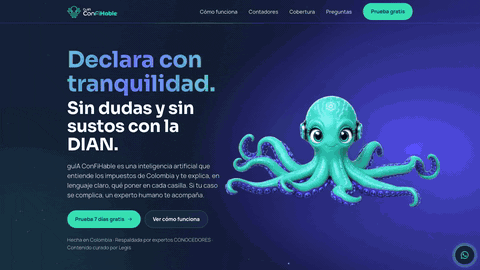</a> 
      <b>guÍA conFiHable</b> Landing for an AI tax assistant that explains Colombian taxes in plain language
    </td>
    <td width="50%" valign="top" align="center">
      <a href="https://oplupconsulting.com/">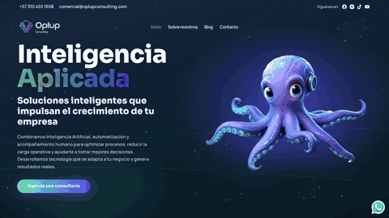</a> 
      <b>Oplup Consulting</b> Corporate site for an applied-AI consultancy
    </td>
  </tr>
  <tr>
    <td width="50%" valign="top" align="center">
      <a href="https://www.mawat.io/">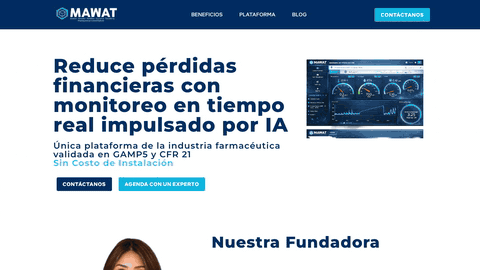</a> 
      <b>MAWAT</b> Site for an AI-powered real-time monitoring platform for the pharma industry
    </td>
    <td width="50%" valign="top" align="center">
       
      <b>Production dashboard</b> Custom app that cut an animation studio's production time by 60% · React, MUI, Node.js, MongoDB
    </td>
  </tr>
  <tr>
    <td colspan="2" valign="top" align="center">
      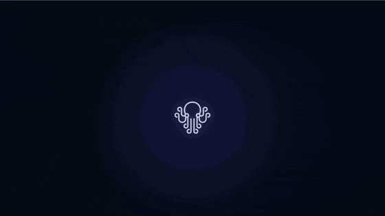 
      <b>NecTeon Office</b> <code>personal project</code> Live 3D office where each AI agent works at its desk as a block figure, walks between departments and opens its profile card on click · React, TypeScript, Three.js 3D figures and bricks by <a href="https://blendswap.com/blend/18390">BornCG</a> / <a href="https://blendswap.com">Blend Swap</a> (CC BY 3.0, fan art, non-commercial)
    </td>
  </tr>
</table>

  

<table>
  <tr>
    <td width="50%" valign="top" align="center">
      <a href="https://vipoptica.com.co/">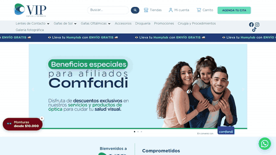</a> 
      <b>VIP Óptica</b> Optical store &amp; pharmacy in Cali · restored, rebuilt and optimized a broken WooCommerce site; ongoing consulting, support and updates
    </td>
    <td width="50%" valign="top" align="center">
       
      <b>Vida Garden Mallorca</b> Luxury landscaping company in Mallorca, Spain
    </td>
  </tr>
  <tr>
    <td width="50%" valign="top" align="center">
       
      <b>Corporación Legends</b> Football and sports physiotherapy organization
    </td>
    <td width="50%" valign="top" align="center">
      <a href="https://aventureros-ecoturismo.netlify.app/">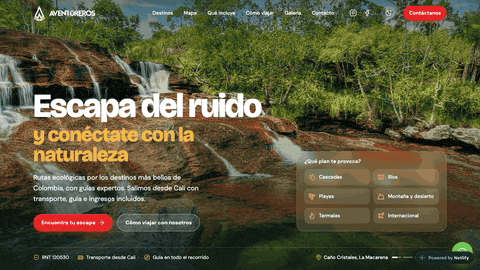</a> 
      <b>Aventureros Ecoturismo</b> <code>personal project</code> Eco-trips from Cali to 19 destinations, with plan filters and an interactive Leaflet map
    </td>
  </tr>
  <tr>
    <td width="50%" valign="top" align="center">
      <a href="https://ajiacotours.com/">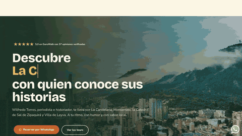</a> 
      <b>Ajiaco Tours</b> Tours in Bogotá and its surroundings with a local guide
    </td>
    <td width="50%" valign="top" align="center">
      <a href="https://cercal.cl/">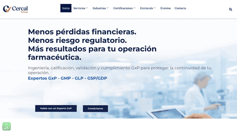</a> 
      <b>Cercal Group</b> Pharma consulting (GxP/GMP) · sole developer, hand in hand with marketing
    </td>
  </tr>
  <tr>
    <td width="50%" valign="top" align="center">
      <a href="https://cercal.online/">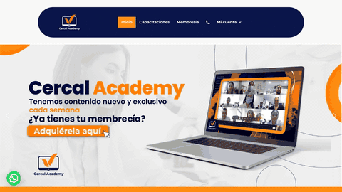</a> 
      <b>Cercal Academy</b> E-learning platform on the regulated industry, with memberships
    </td>
    <td width="50%" valign="top" align="center">
      <a href="https://1cerho.com/">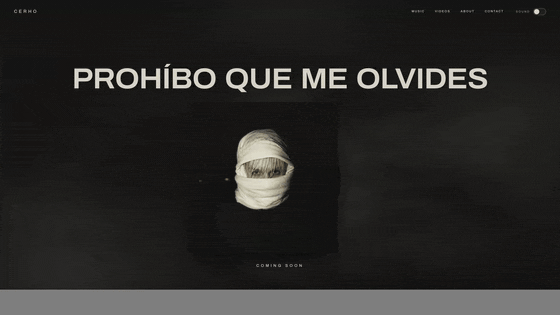</a> 
      <b>Cerho</b> Official site for a Venezuelan R&amp;B singer · rolling 3D-feel vinyl, smoke, sound switch, SEO and GA4 · Vue 3, TypeScript, Vite
    </td>
  </tr>
</table>

  

<table>
  <tr>
    <td width="50%" valign="top" align="center">
       
      <b>Gimnasio Cristiano de Cundinamarca</b> School website with admissions and academic info
    </td>
    <td width="50%" valign="top" align="center">
      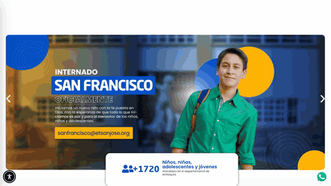 
      <b>Escuela de Trabajo San José</b> Institutional site for a school serving 1,700+ kids and youth in Antioquia
    </td>
  </tr>
  <tr>
    <td width="50%" valign="top" align="center">
      <a href="https://fundacionpazybien.co/">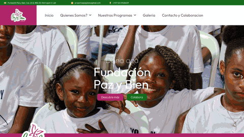</a> 
      <b>Fundación Paz y Bien</b> Website for a social foundation and its programs
    </td>
    <td width="50%" valign="top" align="center">
      <a href="https://mujeresenlaindustria.org/">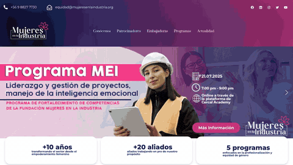</a> 
      <b>Mujeres en la Industria</b> Latin American network for gender equity in industry
    </td>
  </tr>
</table>

  

Most of my work lives in private repos, so what you see here is the tip of the iceberg.

  

  <picture>
    <source media="(prefers-color-scheme: dark)" srcset="https://raw.githubusercontent.com/Drasmaurg/Drasmaurg/output/github-snake-dark.svg" />
    
  </picture>

<i>🐍 A snake eats my contributions every day. Somebody has to.</i>

  

  <a href="mailto:mauricionunez2011@gmail.com"></a>

  
  
  

