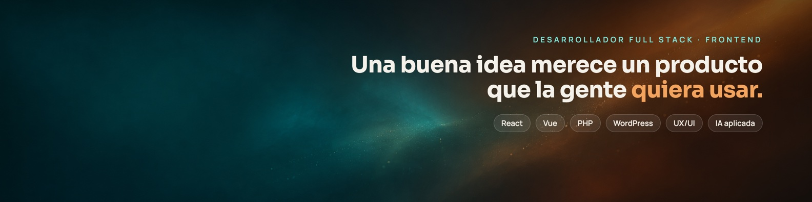
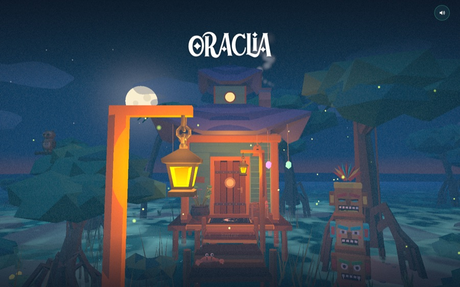
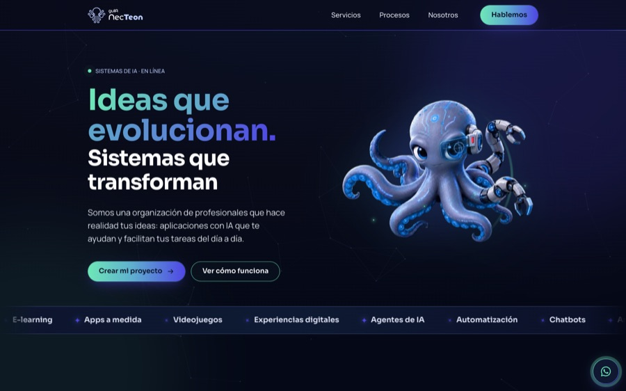
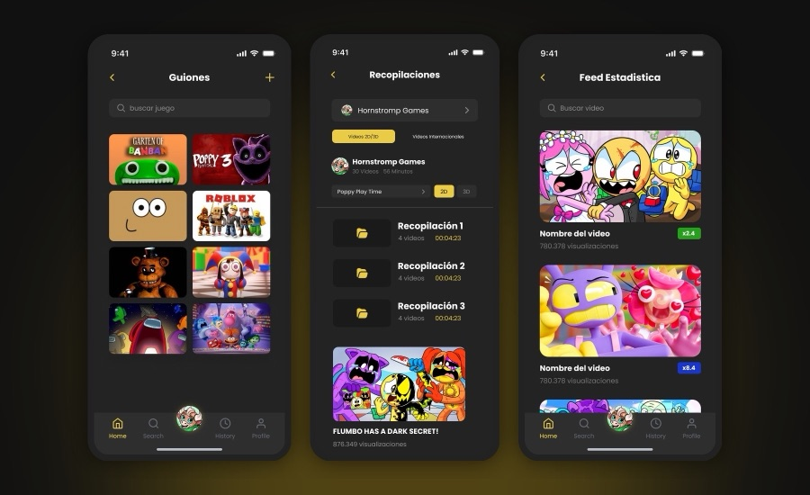
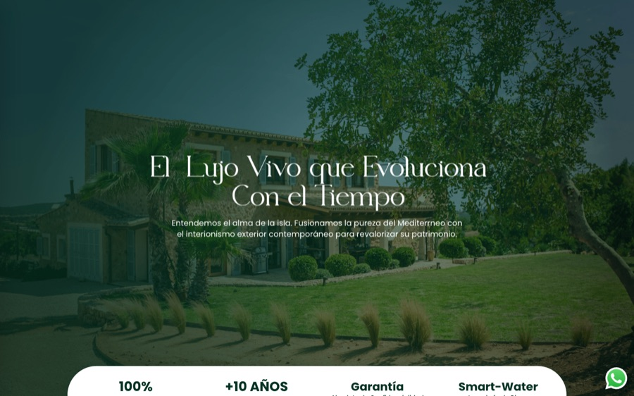
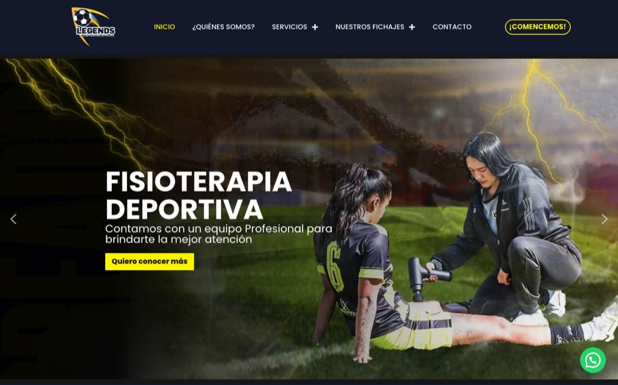
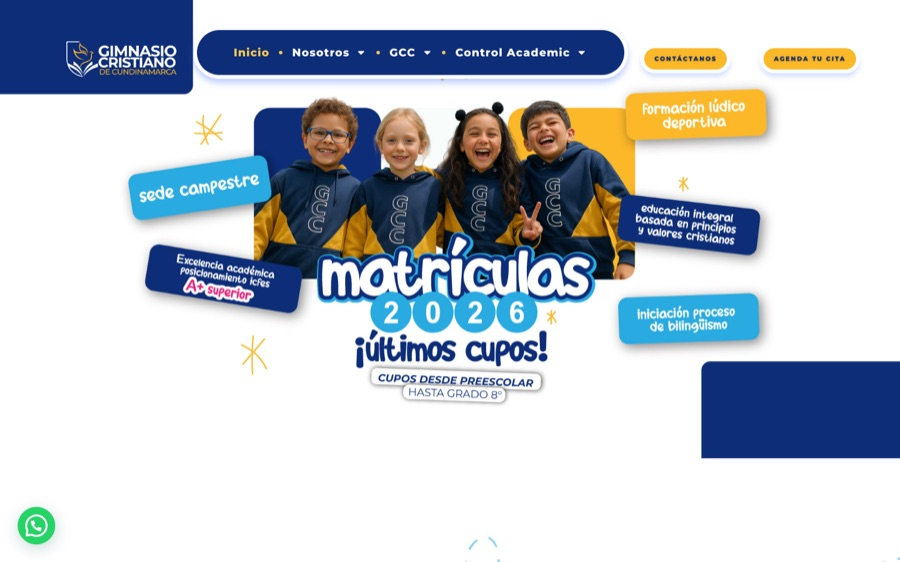

  

  

  
  
  

---

### 🧑‍💻 About me

I'm **Mauricio Núñez**, but everyone calls me **Mauro**. I'm a **Full Stack Developer** with **7+ years** building websites, online stores, platforms and apps for companies in Colombia, Peru, Chile, Venezuela, Spain and beyond. My strength is the **frontend**: I take a design (or a loose idea on a napkin) and turn it into an interface that feels alive, loads fast and works on any screen.

I grew up with classic books, cult films, comics, anime and video games, and a bit of all that ends up in every project I touch.

- 🎨 **Frontend craft:** pixel-perfect layouts, animation, responsive design, UX/UI and technical SEO
- ⚙️ **Full stack:** React and Vue on the front; PHP, Symfony and Node.js on the back
- 🛒 **WordPress & WooCommerce** done right: custom themes and plugins, Elementor, WPBakery
- 🎮 **Web games and interactive experiences** for brands and virtual events
- 🤖 **AI-driven development:** I work daily with agents like Claude Code and Codex. Experience sets the judgment; AI multiplies what I can build
- 🌎 Spanish (native) · English (B2)

> 💡 Fun fact: most of my work lives in private repos, so the green squares below are the tip of the iceberg.

---

### 🛠️ Tech stack

   
   
  

---

### 🚀 Some things I've built

<table>
  <tr>
    <td width="50%" valign="top">
      
      <b>Oraclia</b> · Interactive 3D tarot experience with an illustrated scene, animation and plain-language readings.
    </td>
    <td width="50%" valign="top">
      
      <b>guIA NecTeon</b> · Animated landing for an AI solutions brand: Vue 3, TypeScript, Vite and GSAP.
    </td>
  </tr>
  <tr>
    <td width="50%" valign="top">
      
      <b>Production dashboard</b> · Custom app that centralized an animation studio's whole production and cut production time by 60%. React, Material UI, Node.js, MongoDB.
    </td>
    <td width="50%" valign="top">
      
      <b>Vida Garden Mallorca</b> · Corporate site for a luxury landscaping company in Mallorca, Spain.
    </td>
  </tr>
  <tr>
    <td width="50%" valign="top">
      
      <b>Corporación Legends</b> · Website for a football and sports physiotherapy organization.
    </td>
    <td width="50%" valign="top">
      
      <b>Gimnasio Cristiano de Cundinamarca</b> · School website with admissions and academic info.
    </td>
  </tr>
</table>

---

### 📊 GitHub activity

  

  <picture>
    <source media="(prefers-color-scheme: dark)" srcset="https://raw.githubusercontent.com/Drasmaurg/Drasmaurg/output/github-snake-dark.svg" />
    
  </picture>

<i>🐍 A snake eats my contributions every day. Somebody has to.</i>

---

  <b>Got an idea? Let's make it real.</b> 
  <a href="https://www.linkedin.com/in/mauricionunez-dev">LinkedIn</a> · <a href="mailto:mauricionunez2011@gmail.com">mauricionunez2011@gmail.com</a>

