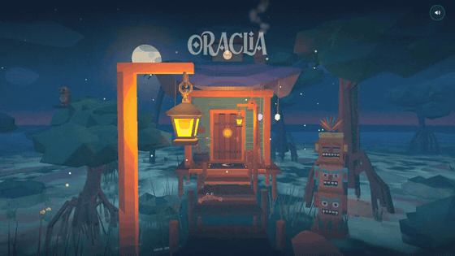
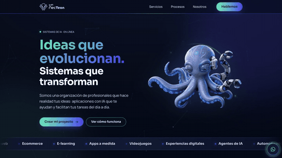
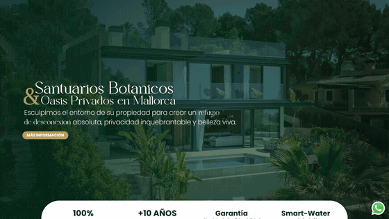
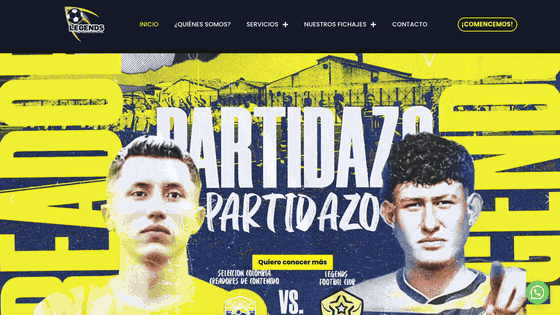
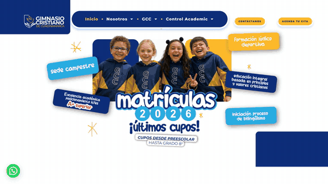

  

  
  
  

  

### 🧑‍💻 About me

I'm **Mauricio Núñez**, but everyone calls me **Mauro**. Full Stack Developer with **7+ years** building websites, online stores, platforms and apps for companies in Colombia, Peru, Chile, Venezuela, Spain and beyond. My thing is the **frontend**: I take a design (or a loose idea on a napkin) and turn it into an interface that feels alive, loads fast and works on any screen.

I grew up on classic books, cult films, comics, anime and video games, and a bit of all that sneaks into every project.

| 🎨 Frontend craft | ⚙️ Full stack | 🎮 Interactive | 🤖 AI-driven |
| :-- | :-- | :-- | :-- |
| Pixel-perfect layouts, animation, responsive, UX/UI, technical SEO | React · Vue on the front; PHP · Symfony · Node.js on the back | Web games and digital experiences for brands and virtual events | Daily work with Claude Code and Codex: experience sets the judgment, AI multiplies the output |

### 🛠️ Toolbox

  

### 🚀 Things I've built (they move, scroll through them)

<table>
  <tr>
    <td width="50%" valign="top" align="center">
       
      <b>Oraclia</b> Interactive 3D tarot with an illustrated scene and plain-language readings
    </td>
    <td width="50%" valign="top" align="center">
       
      <b>guIA NecTeon</b> Animated landing for an AI brand · Vue 3, TypeScript, Vite, GSAP
    </td>
  </tr>
  <tr>
    <td width="50%" valign="top" align="center">
       
      <b>Vida Garden Mallorca</b> Luxury landscaping company in Mallorca, Spain
    </td>
    <td width="50%" valign="top" align="center">
       
      <b>Corporación Legends</b> Football and sports physiotherapy organization
    </td>
  </tr>
  <tr>
    <td width="50%" valign="top" align="center">
       
      <b>Gimnasio Cristiano de Cundinamarca</b> School website with admissions and academic info
    </td>
    <td width="50%" valign="top" align="center">
       
      <b>Production dashboard</b> Custom app that cut an animation studio's production time by 60% · React, MUI, Node.js, MongoDB
    </td>
  </tr>
</table>

### 📊 Activity

> 💡 Most of my work lives in private repos, so what you see here is the tip of the iceberg.

  

  <picture>
    <source media="(prefers-color-scheme: dark)" srcset="https://raw.githubusercontent.com/Drasmaurg/Drasmaurg/output/github-snake-dark.svg" />
    
  </picture>

<i>🐍 A snake eats my contributions every day. Somebody has to.</i>

---

  <b>Got an idea? Let's make it real.</b> 
  <a href="https://www.linkedin.com/in/mauricionunez-dev">LinkedIn</a> · <a href="mailto:mauricionunez2011@gmail.com">mauricionunez2011@gmail.com</a>

